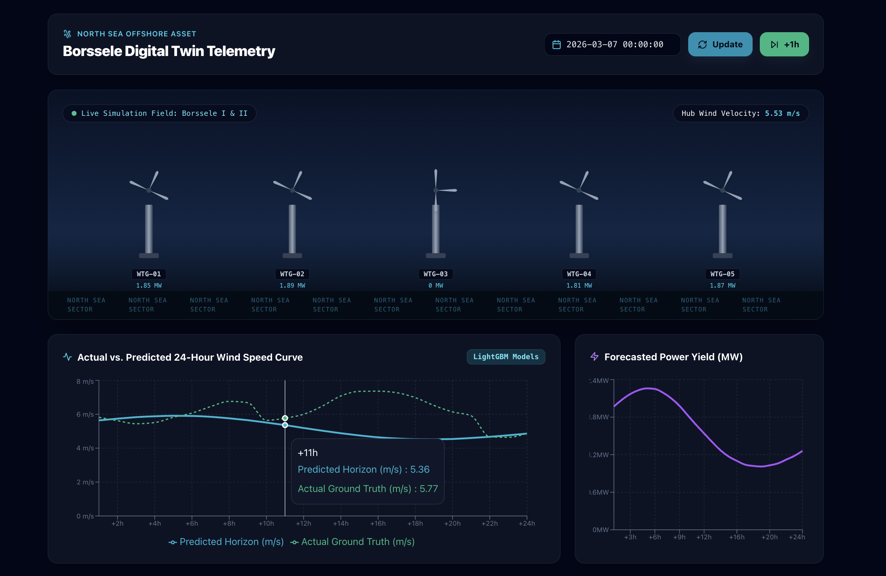

# Borssele Digital Twin: Offshore Wind & Power Telemetry Engine 🌊💨

An end-to-end, real-time offshore wind energy digital twin and telemetry dashboard developed for the **Borssele Wind Farm** in the North Sea. The system ingests high-resolution ERA5 meteorological vector components ($u_{100}, v_{100}, t_{2m}, sp$) to compute scalar wind speeds, evaluate turbine aerodynamic power production, and forecast multi-horizon power outputs using LightGBM boosters coupled with physics-based fallbacks.

---

## System Overview & Visuals

<!-- PLACEHOLDER FOR WIND POWER PLANT PHOTO -->
<div align="center">
  
  <p><em>Figure 1: Borssele Offshore Wind Farm (North Sea)</em></p>
</div>

<br />

<!-- PLACEHOLDER FOR UI SCREENSHOT -->
<div align="center">
  
  <p><em>Figure 2: Real-time Telemetry and 24-Hour Predictive Dashboard UI</em></p>
</div>

---

## Architecture & Features

- **Frontend:** Built with React, Vite, and Tailwind CSS; served via Nginx for high-performance dashboard rendering.
- **Backend Service:** FastAPI orchestration layer delivering dynamic forecast telemetry and physics calculations.
- **Physics Engine:** Real-time aerodynamic power conversion based on the kinetic energy equation:
  $$P = \frac{1}{2} \rho A v^3 \cdot \eta$$
  *(utilizing standard air density $\rho = 1.225 \text{ kg/m}^3$, rotor swept area $A = 18,626 \text{ m}^2$, and nameplate capacity of 8.0 MW per turbine)*.
- **Predictive Model:** 24 sequential LightGBM model boosters (`model_h1.txt` through `model_h24.txt`) for multi-step hourly wind speed forecasting.
- **Model Evaluation:** Benchmarked under high-wind/extreme weather events ($> 15 \text{ m/s}$):
  - **+1h Horizon:** RMSE $0.77 \text{ m/s}$, MAE $0.51 \text{ m/s}$
  - **+6h Horizon:** RMSE $2.98 \text{ m/s}$, MAE $2.29 \text{ m/s}$
  - **+12h Horizon:** RMSE $5.06 \text{ m/s}$, MAE $4.51 \text{ m/s}$

---

## Quick Start (Using Docker Compose)

### Prerequisites
- [Docker Engine](https://docs.docker.com/get-docker/) (v20+ recommended)
- [Docker Compose](https://docs.docker.com/compose/)

### 1. Clone the Repository
```bash
git clone https://github.com/your-username/borssele-digital-twin.git
cd borssele-digital-twin
```

### 2. Prepare Data & Model Artifacts
Ensure your dataset and model files are placed in the expected directories:
- Place `df26.csv` in `backend/data/`
- Place model text files (`model_h1.txt` ... `model_h24.txt`) in `backend/models/wind_forecast_v1/`

### 3. Build and Run Containers
Launch both backend (FastAPI) and frontend (Nginx/React) services with a single command:

```bash
docker compose up --build -d
```

### 4. Access the Application
- **Interactive Dashboard:** Open [`http://localhost`](http://localhost) in your browser.
- **FastAPI OpenAPI Docs:** Access [`http://localhost:8000/docs`](http://localhost:8000/docs) to inspect API endpoints.

---

## Local Development Setup (Without Docker)

### Backend Setup
```bash
cd backend
python -m venv venv
source venv/bin/activate  # On Windows: venv\Scripts\activate
pip install -r requirements.txt
uvicorn main:app --reload --port 8000
```

### Frontend Setup
```bash
cd frontend
npm install
npm run dev
```

---

## Stopping the Services

To stop all containerized services:
```bash
docker compose stop
```

To stop and remove containers along with networks:
```bash
docker compose down
```
